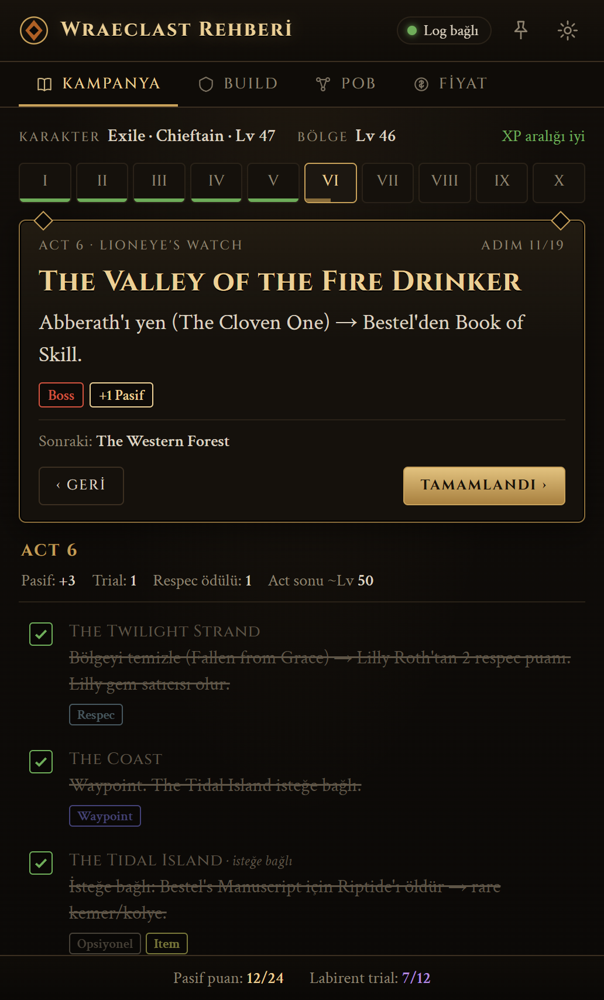
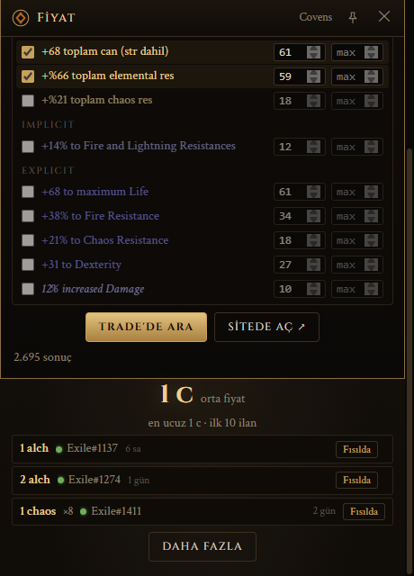
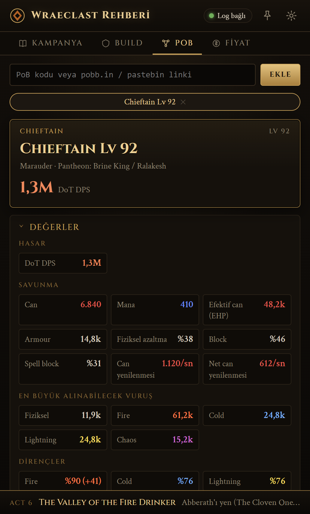
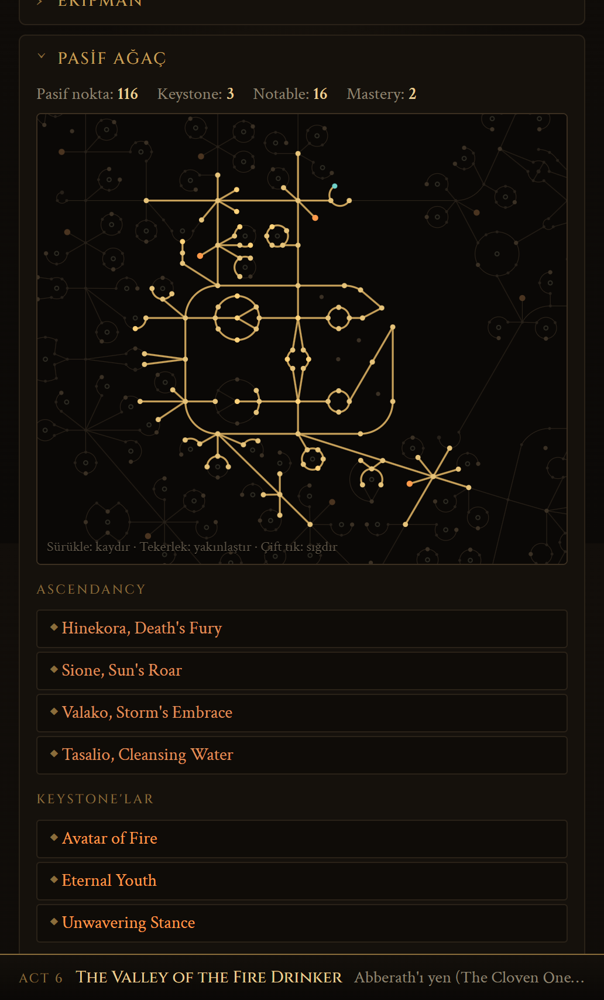
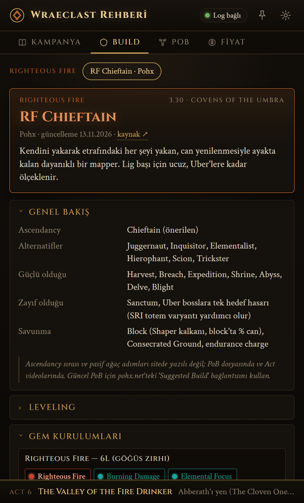
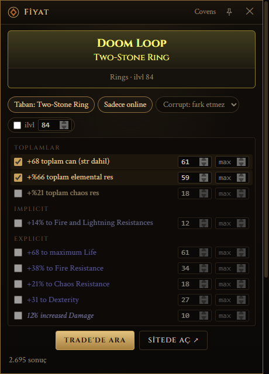

<div align="center">


# Wraeclast Rehberi

**Path of Exile 1 için ikinci ekran yardımcısı** — kampanya rehberi, build rehberleri,
sade bir Path of Building görüntüleyici ve Awakened PoE Trade tarzı fiyat sorgusu tek uygulamada.

*A second-screen companion for Path of Exile 1: campaign guide, build guides, a lightweight PoB viewer and price checking.*

[](https://github.com/kiddhazel/wraeclast-rehberi/releases/latest)


</div>

---

<table>
<tr>
<td width="50%"></td>
<td width="50%"></td>
</tr>
<tr>
<td align="center"><b>Kampanya</b> — log'dan otomatik ilerleyen Act 1–10 rehberi</td>
<td align="center"><b>Fiyat</b> — Ctrl+C ile imlecin yanında açılan popup</td>
</tr>
</table>

## ✨ Özellikler

### 📜 Kampanya rehberi
- **Act 1–10** tam rota: her bölgede ne yapılacağı, hangi görevin ne verdiği.
- Pasif puanlar (**24/24** sayacı), labirent trial'ları (**12/12**), respec ödülleri, gem ödülleri ve Kitava'nın resist cezası uyarıları.
- **Otomatik ilerleme:** Oyunun `Client.txt` log'u okunur; bölgeye girince rehber o adıma geçer, bitirdiğin adımlar kendiliğinden işaretlenir. Uygulamayı Act 6'da ilk kez açsan bile kaldığın yere yetişir.
- Karakter seviyesi ve bölge seviyesine göre **XP cezası uyarısı**.
- Log dosyası Steam / standalone kurulumlarında, farklı sürücülerde bile otomatik bulunur.

### 💰 Fiyat sorgusu (Awakened PoE Trade tarzı)
- Oyunda item'ın üzerinde **Ctrl+C** → imlecin yanında popup açılır. Oyuna hiçbir tuş gönderilmez, yalnızca pano okunur.
- **Unique, gem, currency, fragment, div card** → [poe.ninja](https://poe.ninja) fiyatı (link sayısına göre varyant).
- **Rare item'lar** → resmi trade API: her mod için aç/kapa + **min/max**, toplam can / elemental res / chaos res (pseudo) filtreleri.
- Taban ↔ kategori, online, corrupted, influence, fractured, ilvl, quality, link, pDPS/eDPS, armour/ES, map tier, gem level filtreleri.
- Aynı fiyattaki ilanlar gruplanır, **"Fısılda"** düğmesi whisper mesajını kopyalar.

### 🌳 PoB görüntüleyici
- PoB kodu, **pobb.in** veya **pastebin** linki yapıştır.
- Gruplu değerler: hasar, savunma, EHP, en büyük alınabilecek vuruş, overcap'li dirençler, charge'lar.
- GGG'nin resmi verisiyle çizilen **interaktif pasif ağaç** (sürükle, yakınlaştır, üzerine gelince açıklama).
- Keystone, notable, mastery ve ascendancy listeleri; gem setleri, item setleri, ağaçtaki jewel'lar, notlar.

### 🛡️ Build rehberleri
- Kategorili rehberler — ilk olarak **Pohx'un RF Chieftain** rehberi (3.30): gem kurulumları, ekipman sırası, hedef değerler, adım adım **craft** tarifleri, flask/pantheon, bütçe kademeleri.

<table>
<tr>
<td width="33%"></td>
<td width="33%"></td>
<td width="33%"></td>
</tr>
<tr>
<td align="center"><b>PoB</b> — gruplu değerler</td>
<td align="center"><b>Pasif ağaç</b> — interaktif</td>
<td align="center"><b>Build</b> — Pohx RF</td>
</tr>
</table>

<p align="center"><br/><sub>Rare item filtreleri: mod başına min/max, pseudo toplamlar, influence</sub></p>

## 📥 Kurulum

1. [**Releases**](https://github.com/kiddhazel/wraeclast-rehberi/releases/latest) sayfasından `Wraeclast Rehberi_x.y.z_x64-setup.exe` dosyasını indir.
2. Çalıştır — yönetici izni gerekmez, yalnızca senin kullanıcına kurulur.
3. Windows "bilgisayarınızı korudu" derse: **Ek bilgi → Yine de çalıştır** (uygulama imzasız olduğu için).

> **İpucu:** Fiyat popup'ının oyunun üstünde görünmesi için PoE'yi **Windowed Fullscreen** modunda oyna.

## 🎮 Kullanım

| Ne | Nasıl |
|---|---|
| Kampanya takibi | Uygulamayı aç, oyuna gir — log otomatik bağlanır. Bulamazsa ⚙️ → *Dosya seç…* ile `Path of Exile\logs\Client.txt` |
| Fiyat | Oyunda item üzerinde `Ctrl+C`. Popup'ı `Esc` ya da oyuna tıklayarak kapat; 📌 ile sabitle |
| PoB | PoB sekmesi → kodu ya da linki yapıştır → *Ekle* |
| Her zaman üstte | Üst bardaki 📌 düğmesi |
| Adım atla / geri | Kampanya sekmesinde `→` / `←` |

## 🛠️ Kaynaktan derleme

Gereksinimler: [Rust](https://rustup.rs), Visual Studio C++ Build Tools, WebView2 (Windows 11'de hazır).

```powershell
cargo install tauri-cli --version "^2"
cd src-tauri
cargo test          # log, pano ve HTTP testleri
cargo tauri dev     # geliştirme modu
cargo tauri build   # kurulum dosyası
```

Arayüz Node gerektirmez (saf HTML/CSS/JS). Sadece arayüzü tarayıcıda görmek için:
`powershell -ExecutionPolicy Bypass -File tools\serve.ps1` → http://localhost:5180

<details>
<summary><b>Proje yapısı</b></summary>

```
src/                    Arayüz (HTML/CSS/JS)
  app.js                Kampanya rehberi, otomatik ilerleme/işaretleme
  builds-ui.js          Build sekmesi
  pob.js · tree.js      PoB çözme, değerler, pasif ağaç çizimi
  price-core.js         Item ayrıştırma, poe.ninja, trade API sorguları
  price-ui.js           Fiyat arayüzü (sekme + popup ortak)
  popup.html · popup.js Fiyat popup penceresi
  data/acts.js          Act 1–10 rehber verisi (düzenlenebilir)
  data/builds.js        Build rehberleri (düzenlenebilir)
src-tauri/src/
  log_watcher.rs        Client.txt izleyici + kurulum yolu tespiti
  clipboard.rs          Pano izleyici (oyundan kopyalanan item'lar)
  popup.rs              İmleç yanında açılan popup penceresi
  net.rs                İzinli sitelere HTTP köprüsü + disk önbelleği
```
</details>

## 🙏 Teşekkürler ve kaynaklar

- Fiyat verisi: [poe.ninja](https://poe.ninja) · resmi [Path of Exile Trade](https://www.pathofexile.com/trade) API
- Pasif ağaç verisi: [grindinggear/skilltree-export](https://github.com/grindinggear/skilltree-export)
- RF rehberi içeriği [pohx.net](https://pohx.net)'ten özetlenmiştir — tüm emek Pohx ve topluluğa aittir; güncel PoB için kaynağa bakın.
- Kampanya rotası topluluk rehberleriyle (ör. heavyheals.com) karşılaştırılarak hazırlanmıştır.
- İlham: [Path of Building](https://pathofbuilding.community), [Awakened PoE Trade](https://github.com/SnosMe/awakened-poe-trade)

## ⚖️ Yasal

Bu proje Grinding Gear Games ile bağlantılı değildir ve onlar tarafından onaylanmamıştır.
Path of Exile, Grinding Gear Games'in ticari markasıdır. Uygulama oyun dosyalarını değiştirmez,
oyuna tuş/fare girdisi göndermez; yalnızca oyunun yazdığı log dosyasını ve panoyu okur.

Lisans: [MIT](LICENSE)
